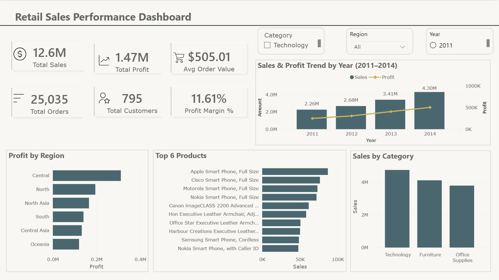

# Retail Sales Performance Analysis

## Dashboard Preview



## Summary

Sales grew every year from 2011 to 2014, but heavy discounts removed a large part of the profit. Order lines discounted above 20% were 22% of all lines and lost $815K in total.

## Key Results

| Measure | Result |
| --- | --- |
| Total sales | $12.64M |
| Total profit | $1.47M |
| Profit margin | 11.6% |
| Orders | 25,753 |
| Customers | 795 |
| Average order value | $490.93 |

- Sales rose from $2.26M in 2011 to $4.30M in 2014.
- Technology had the highest sales ($4.74M) and profit ($0.66M).
- APAC was the most profitable market ($436K). EMEA had the lowest margin (5%).

| Discount | Profit margin |
| --- | --- |
| No discount | 25.3% |
| 1-20% | 13.7% |
| 21-40% | -17.3% |
| Over 40% | -74.1% |

## Recommendation

Review discounts above 20% first. This data shows the link between discount and profit, but not why each discount was given.

## Data

Retail order lines from 2011 to 2014, with 51,290 rows. Some region names, such as Central and South, are used in more than one market. Some order IDs are used by different customers, so an order is counted by order ID and customer in the results above. The Power BI dashboard counts each order ID once, so it shows 25,035 orders and an average order value of $505.01.

## Tools

- Python (Pandas)
- Power BI

## Files

```
retail-sales-performance-analysis/
├── data_analysis.py
├── cleaned_superstore.csv
├── Retail_Sales_Dashboard.pbix
├── dashboard.png
└── README.md
```
